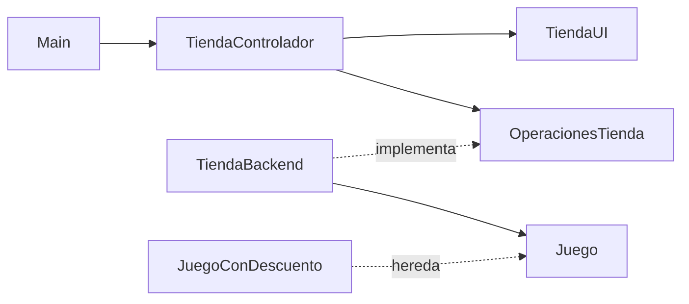

# Tienda de juegos — Semana 2: orientación a objetos en Kotlin

## Ejecutar

Se necesitan Java y el compilador Kotlin (`java` y `kotlinc` disponibles en la terminal). No se usa Gradle ni bibliotecas externas.

Abra PowerShell en esta carpeta:

```powershell
kotlinc (Get-ChildItem -File -Filter *.kt).FullName -include-runtime -d Main.jar
if ($LASTEXITCODE -eq 0) { java -jar Main.jar }
```

También se entrega `Main.jar` compilado. Para ejecutarlo: `java -jar Main.jar`.
En Bash: `kotlinc *.kt -include-runtime -d Main.jar && java -jar Main.jar`.

## Qué se conserva de semana 1

Se revisaron los cuatro fuentes del ZIP original: Juego.kt, Main.kt, Menu.kt y Operaciones.kt. Se mantienen la bienvenida con catálogo, los 20 juegos con sus precios y stock, los IDs automáticos y las opciones:

1. Agregar juego.
2. Sumar stock.
3. Cotizar y confirmar o cancelar un pedido de un juego por vez.
4. Consultar unidades vendidas y recaudación por juego y global.
0. Salir.

Los datos siguen en memoria: al cerrar se pierden las modificaciones. Los precios son ilustrativos en pesos chilenos.

## Arquitectura



| Archivo | Responsabilidad y concepto OO |
|---|---|
| Main.kt | Crea los objetos iniciales, conecta las dependencias y arranca el controlador. |
| Juego.kt | Modelo con estado y comportamiento: cotiza, repone y vende. Encapsula stock, vendidos y totalVentas mediante `private set`. |
| JuegoConDescuento.kt | Única subclase. Usa herencia y `override` para personalizar el porcentaje. |
| OperacionesTienda.kt | Interfaz: contrato de las operaciones que utiliza el controlador. |
| TiendaBackend.kt | Implementa el contrato, administra el catálogo y valida operaciones. Sin entrada ni salida por consola. |
| TiendaUI.kt | Lee y valida la conversión de entradas; presenta menú, catálogo, pedidos, errores y estadísticas. |
| TiendaControlador.kt | Coordina el flujo. Depende de la interfaz y pide a la UI presentar los resultados. |
| Resultados.kt | Datos de salida: fichas, pedidos, estadísticas, resultados y códigos de error. |

Todos los fuentes están en la misma carpeta, sin paquetes, para concentrar la sesión en OO. La única jerarquía de juegos tiene dos niveles: `Juego` → `JuegoConDescuento`. Los objetos que solo transportan datos siguen siendo `data class`; `Juego` deja de serlo porque ahora protege y modifica su estado.

`Resultado<T>` contiene un dato en caso de éxito o un `ErrorOperacion` si falla. Su constructor privado y sus funciones `exito` y `fallo` evitan combinaciones inconsistentes. `T` representa el tipo de dato retornado, por ejemplo `Pedido` o `FichaJuego`. No se usan excepciones para errores normales de usuario; los `require` del modelo protegen su uso directo desde código.

El backend retorna fichas inmutables, de modo que la UI no recibe los juegos modificables. Los códigos de error se convierten en mensajes dentro de la UI. Esta separación permite cambiar la presentación sin reescribir las ventas.

## Descuentos y polimorfismo

- `Juego`: conserva el descuento original de 20 % si la cantidad es mayor que uno; para una unidad es 0 %.
- `JuegoConDescuento`: permite un porcentaje propio entre 1 y 100. Aplica el mayor entre ese porcentaje y el descuento original; no se suman.
- Al agregar un juego, 0 crea un `Juego` estándar y 1–100 crea un `JuegoConDescuento`.
- Dixit tiene 10 % personalizado y Wingspan 25 %. Los restantes juegos conservan el comportamiento estándar.

Ejemplos:

| Juego | Cantidad | Subtotal | Descuento aplicado | Total |
|---|---:|---:|---:|---:|
| Catan | 1 | $35.000 | 0 % | $35.000 |
| Catan | 2 | $70.000 | 20 % | $56.000 |
| Dixit | 1 | $30.000 | 10 % | $27.000 |
| Dixit | 2 | $60.000 | 20 % | $48.000 |
| Wingspan | 2 | $110.000 | 25 % | $82.500 |

`Juego.cotizar()` invoca `porcentajeDescuento()`. Aunque el catálogo sea una lista de `Juego`, Kotlin ejecuta el método sobrescrito cuando el objeto real es `JuegoConDescuento`. No hay un `if` por tipo en la venta.

Los importes se calculan con `Long`; el descuento se calcula sobre el subtotal y se trunca a pesos enteros, como en semana 1. Se valida que una reposición no desborde el stock de tipo `Int`.

## Recorrido de un pedido

1. El controlador pide ID y cantidad a la UI.
2. El backend comprueba que el juego exista, que la cantidad sea positiva y que alcance el stock.
3. El modelo calcula el pedido con su descuento; cotizar no modifica nada.
4. La UI presenta el resumen y solicita confirmación.
5. Si se cancela, el controlador no llama a confirmar.
6. Si se confirma, el backend valida nuevamente y el modelo descuenta stock y acumula unidades y el total efectivamente pagado.

La confirmación recibe ID y cantidad y recalcula el importe; no acepta totales arbitrarios desde la UI. Este ejemplo es de consola, secuencial y en memoria, sin concurrencia ni persistencia.

## Propuesta de explicación en clase

1. Comparar el antiguo `data class Juego` con el modelo actual: ¿quién debería poder cambiar el stock?
2. Mostrar `private set`, los métodos del modelo y las validaciones.
3. Cotizar una y dos unidades de Catan, Dixit y Wingspan para explicar `open`, `override`, `super` y polimorfismo.
4. Leer la interfaz antes del backend: distinguir el contrato de su implementación.
5. Seguir un pedido desde el controlador hasta el resultado y su impresión en la UI.
6. Cancelar una compra y comprobar que las estadísticas permanecen iguales.

## Verificación

Los controles ejecutados se documentan en `VERIFICACION.md`. La carpeta `pruebas` contiene comprobaciones del backend sin frameworks. Para repetirlas desde esta carpeta:

```powershell
New-Item -ItemType Directory -Force build | Out-Null
kotlinc (Get-ChildItem -File -Filter *.kt).FullName pruebas/Pruebas.kt -include-runtime -d build/Pruebas.jar
if ($LASTEXITCODE -eq 0) { java -cp build/Pruebas.jar PruebasKt }
```

No agregue `-Recurse` a la compilación normal: las pruebas tienen su propio `main`.
